# ambientCG: Bricks materials

**24 assets from [ambientCG](https://ambientcg.com), dedicated to the public domain under [CC0](https://docs.ambientcg.com/license/).** Use them in any game, free or paid, and change them however you like; no credit is needed.

PBR materials as 1K and 2K JPG maps (colour, normal GL and DX, roughness, AO, displacement), one folder per resolution. 863.2 MB in all.

This is a copy kept by [zuujis-cc0](https://github.com/zuujis-cc0) so game makers can take single files from GitHub. It is not made by or affiliated with ambientCG: the originals, often in more formats and higher resolutions, are on [ambientcg.com](https://ambientcg.com). If they help you, consider [supporting ambientCG](https://www.patreon.com/ambientCG).

Every file is listed in [MANIFEST.tsv](MANIFEST.tsv) with its size and SHA-256. More free assets: [the Zuujis collection](https://github.com/zuujis-cc0/free-game-assets#readme).

| | | | |
| :-: | :-: | :-: | :-: |
| <a href="Bricks050">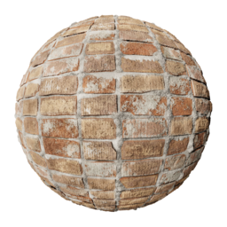</a> <b><a href="Bricks050">Bricks 050</a></b> by ambientCG · <a href="https://ambientcg.com/a/Bricks050">source</a> | <a href="Bricks051">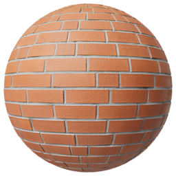</a> <b><a href="Bricks051">Bricks 051</a></b> by ambientCG · <a href="https://ambientcg.com/a/Bricks051">source</a> | <a href="Bricks052">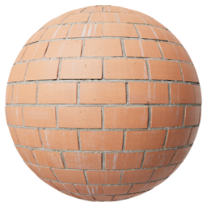</a> <b><a href="Bricks052">Bricks 052</a></b> by ambientCG · <a href="https://ambientcg.com/a/Bricks052">source</a> | <a href="Bricks053">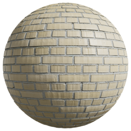</a> <b><a href="Bricks053">Bricks 053</a></b> by ambientCG · <a href="https://ambientcg.com/a/Bricks053">source</a> |
| <a href="Bricks054">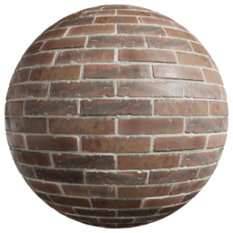</a> <b><a href="Bricks054">Bricks 054</a></b> by ambientCG · <a href="https://ambientcg.com/a/Bricks054">source</a> | <a href="Bricks055">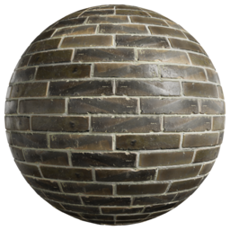</a> <b><a href="Bricks055">Bricks 055</a></b> by ambientCG · <a href="https://ambientcg.com/a/Bricks055">source</a> | <a href="Bricks056">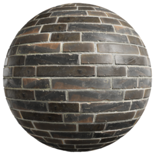</a> <b><a href="Bricks056">Bricks 056</a></b> by ambientCG · <a href="https://ambientcg.com/a/Bricks056">source</a> | <a href="Bricks057">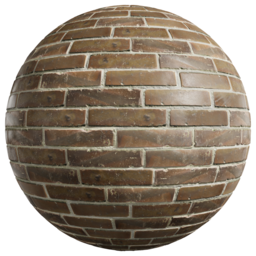</a> <b><a href="Bricks057">Bricks 057</a></b> by ambientCG · <a href="https://ambientcg.com/a/Bricks057">source</a> |
| <a href="Bricks058">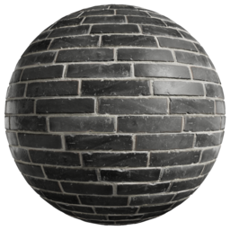</a> <b><a href="Bricks058">Bricks 058</a></b> by ambientCG · <a href="https://ambientcg.com/a/Bricks058">source</a> | <a href="Bricks059">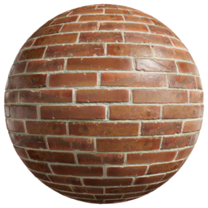</a> <b><a href="Bricks059">Bricks 059</a></b> by ambientCG · <a href="https://ambientcg.com/a/Bricks059">source</a> | <a href="Bricks060">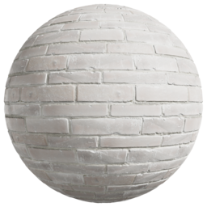</a> <b><a href="Bricks060">Bricks 060</a></b> by ambientCG · <a href="https://ambientcg.com/a/Bricks060">source</a> | <a href="Bricks061">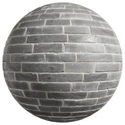</a> <b><a href="Bricks061">Bricks 061</a></b> by ambientCG · <a href="https://ambientcg.com/a/Bricks061">source</a> |
| <a href="Bricks062">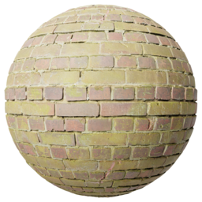</a> <b><a href="Bricks062">Bricks 062</a></b> by ambientCG · <a href="https://ambientcg.com/a/Bricks062">source</a> | <a href="Bricks063">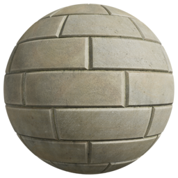</a> <b><a href="Bricks063">Bricks 063</a></b> by ambientCG · <a href="https://ambientcg.com/a/Bricks063">source</a> | <a href="Bricks064">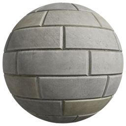</a> <b><a href="Bricks064">Bricks 064</a></b> by ambientCG · <a href="https://ambientcg.com/a/Bricks064">source</a> | <a href="Bricks065">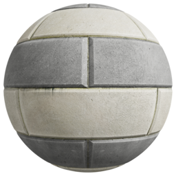</a> <b><a href="Bricks065">Bricks 065</a></b> by ambientCG · <a href="https://ambientcg.com/a/Bricks065">source</a> |
| <a href="Bricks066">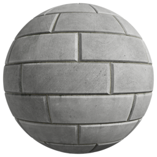</a> <b><a href="Bricks066">Bricks 066</a></b> by ambientCG · <a href="https://ambientcg.com/a/Bricks066">source</a> | <a href="Bricks067">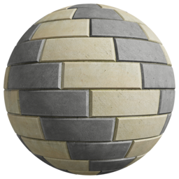</a> <b><a href="Bricks067">Bricks 067</a></b> by ambientCG · <a href="https://ambientcg.com/a/Bricks067">source</a> | <a href="Bricks068">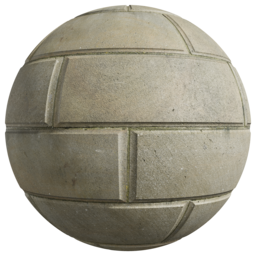</a> <b><a href="Bricks068">Bricks 068</a></b> by ambientCG · <a href="https://ambientcg.com/a/Bricks068">source</a> | <a href="Bricks069">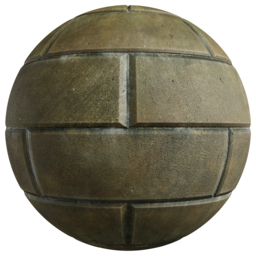</a> <b><a href="Bricks069">Bricks 069</a></b> by ambientCG · <a href="https://ambientcg.com/a/Bricks069">source</a> |
| <a href="Bricks070">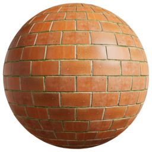</a> <b><a href="Bricks070">Bricks 070</a></b> by ambientCG · <a href="https://ambientcg.com/a/Bricks070">source</a> | <a href="Bricks071">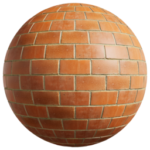</a> <b><a href="Bricks071">Bricks 071</a></b> by ambientCG · <a href="https://ambientcg.com/a/Bricks071">source</a> | <a href="Bricks072">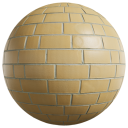</a> <b><a href="Bricks072">Bricks 072</a></b> by ambientCG · <a href="https://ambientcg.com/a/Bricks072">source</a> | <a href="Bricks073A">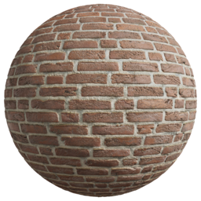</a> <b><a href="Bricks073A">Bricks 073 A</a></b> by ambientCG · <a href="https://ambientcg.com/a/Bricks073A">source</a> |

---

Kept up to date by this repository's own [update workflow](.github/workflows/update.yml), with code and plan from [cc0-mirror](https://github.com/zuujis-cc0/cc0-mirror). Something wrong? [Open an issue there](https://github.com/zuujis-cc0/cc0-mirror/issues/new) or use the [private report form](https://games.zuujis.com/report).
